# Huyền Thoại Bảo Bối (HTBB)

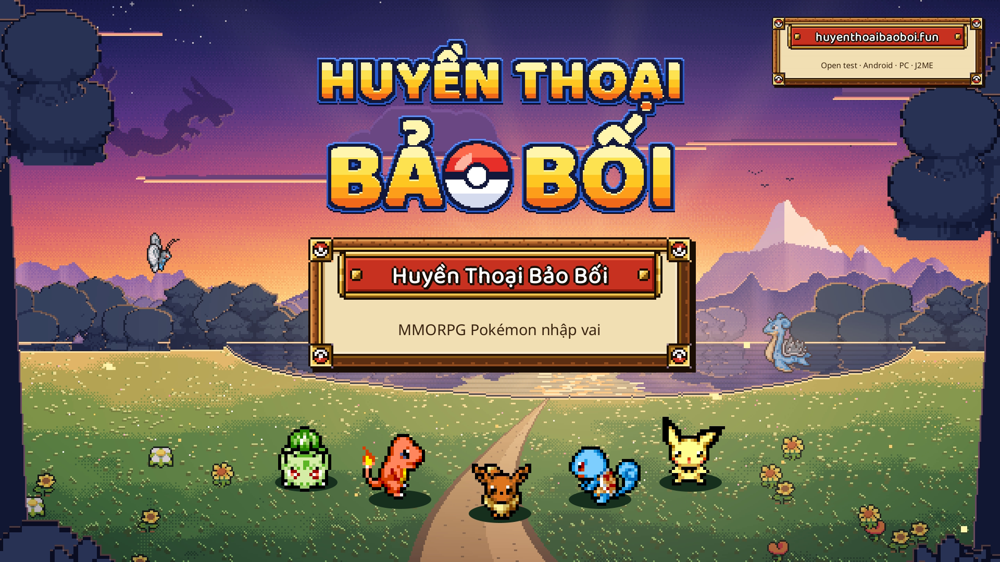

Game nhập vai trực tuyến 2D (**MMORPG Pokémon**), nơi người chơi **là một Pokémon**: khám phá bản đồ Kanto/Johto, đánh quái, bắt Pokémon hoang dã bằng Poké Ball, xem sao IV trong Hộp PC, tiến hoá, thách đấu Gym, đi phó bản, tham gia sự kiện, PvP 3v3 và hệ sinh thái (câu cá, vườn, nấu ăn, ấp trứng…).

Dự án chuyển thể hoàn toàn từ nền tảng MMORPG 2D kiếm hiệp cũ (Java Server + J2ME / Android / PC Java / Unity) sang thế giới Pokémon. Đây là **game fan phi thương mại** — xem [docs/giay-phep.md](docs/giay-phep.md).

- **Website**: `https://huyenthoaibaoboi.fun/`
- **Tải bản cài đặt (`v0.9.33-opentest`)**: Xem [GitHub Releases](https://github.com/hoangtuvungcao/htbb/releases) (Android APK, PC Windows/Linux, J2ME `.jar` thường & nhẹ kèm `SHA256SUMS.txt`)
- **Nhánh mã nguồn**:
  - `main`: nhánh Open Test mới nhất (`v0.9.29-opentest` → `v0.9.33-opentest`)
  - `p2p`: nhánh tích hợp Peerova P2P native/JNI cho Android, PC, Unity và Server (`v0.9.30-p2p`)

---

## Hình ảnh trong Game & Hệ thống Quản trị

| Khởi đầu & Tạo Pokémon | Chiến đấu & Kỹ năng | Pokédex & Tiến hoá |
| :---: | :---: | :---: |
| 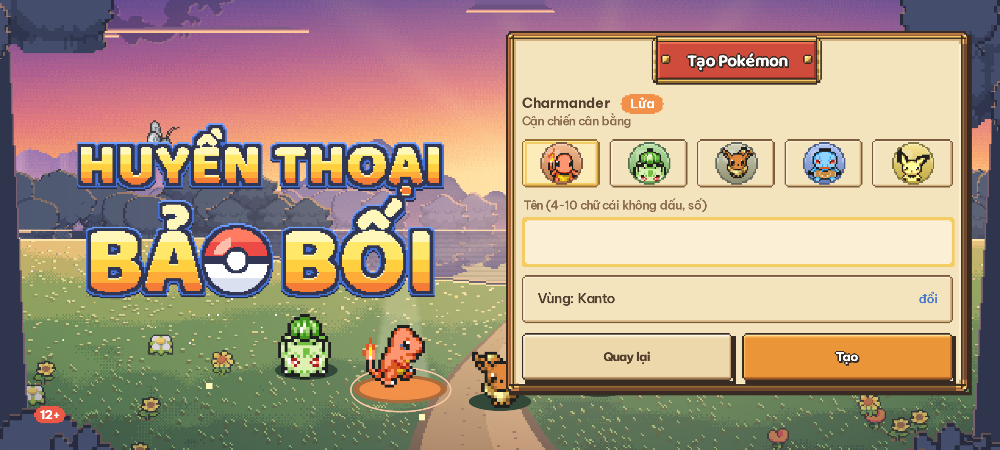 | 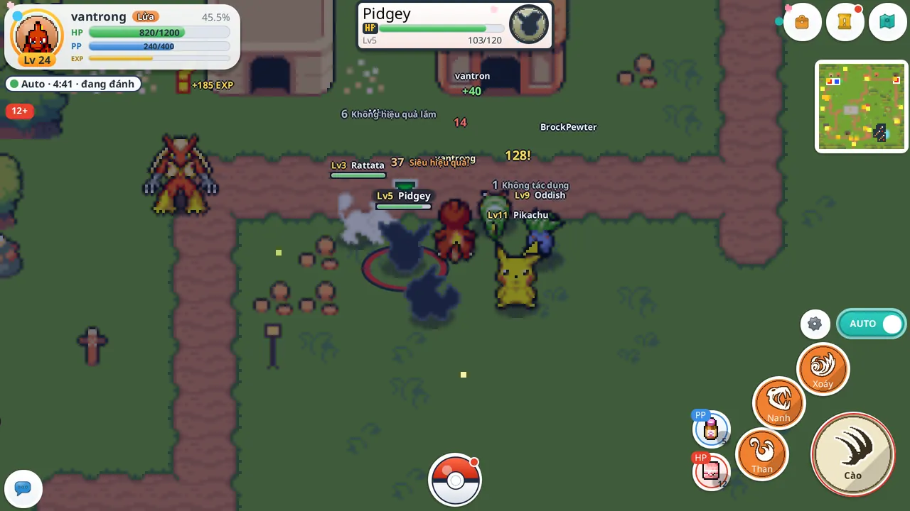 | 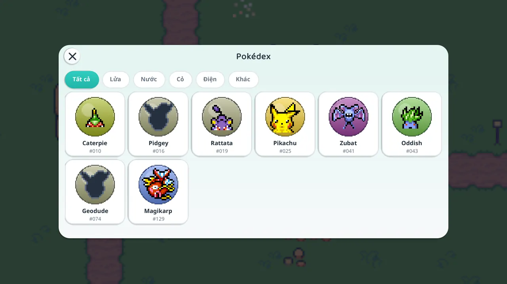 |
| 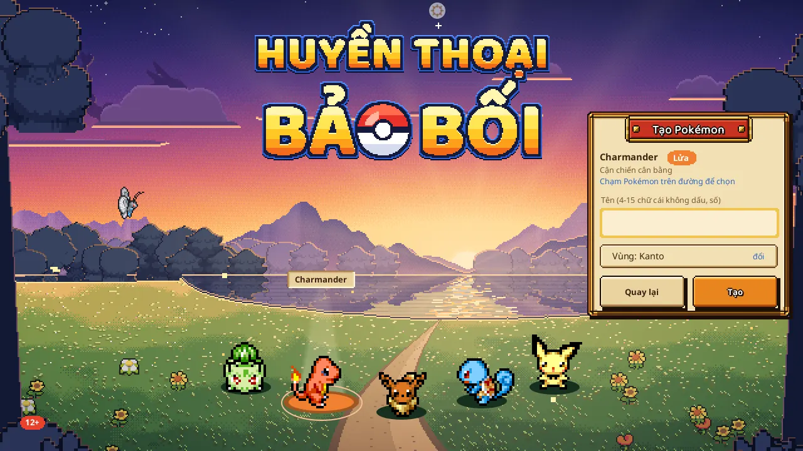 | 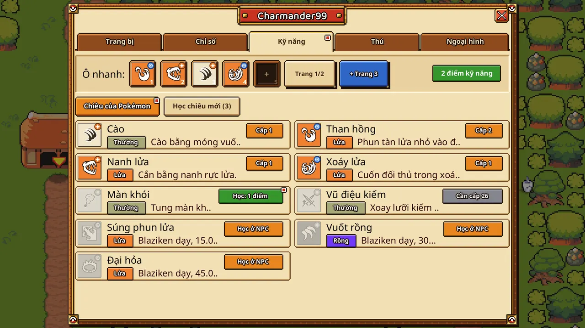 | 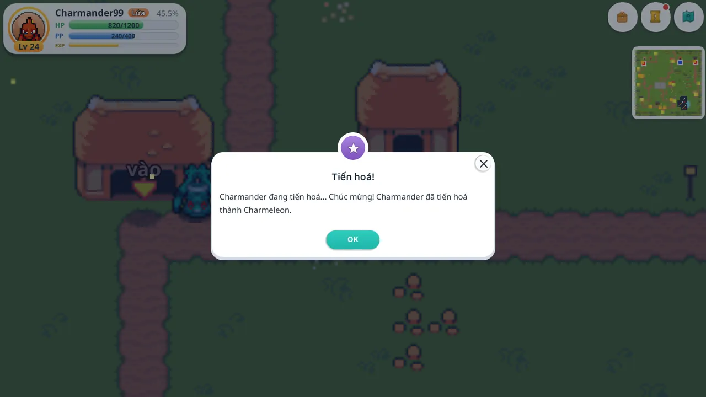 |

| Hộp PC & Thú cưỡi | Phó bản & Cửa hàng | Khu Quản trị Admin & VietQR |
| :---: | :---: | :---: |
| 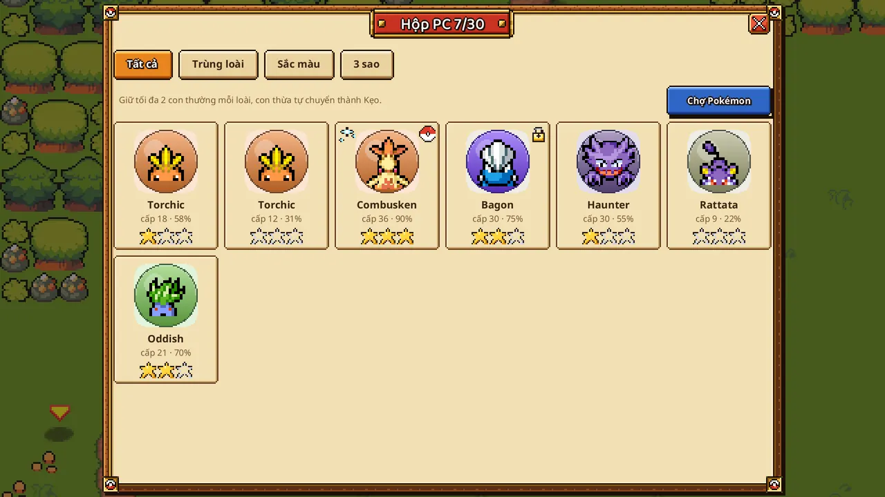 | 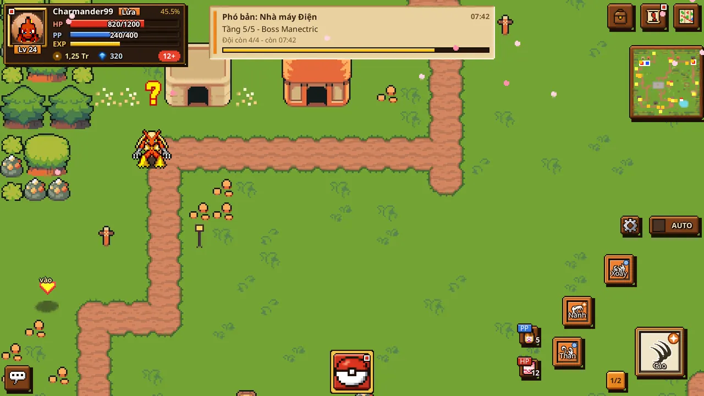 | 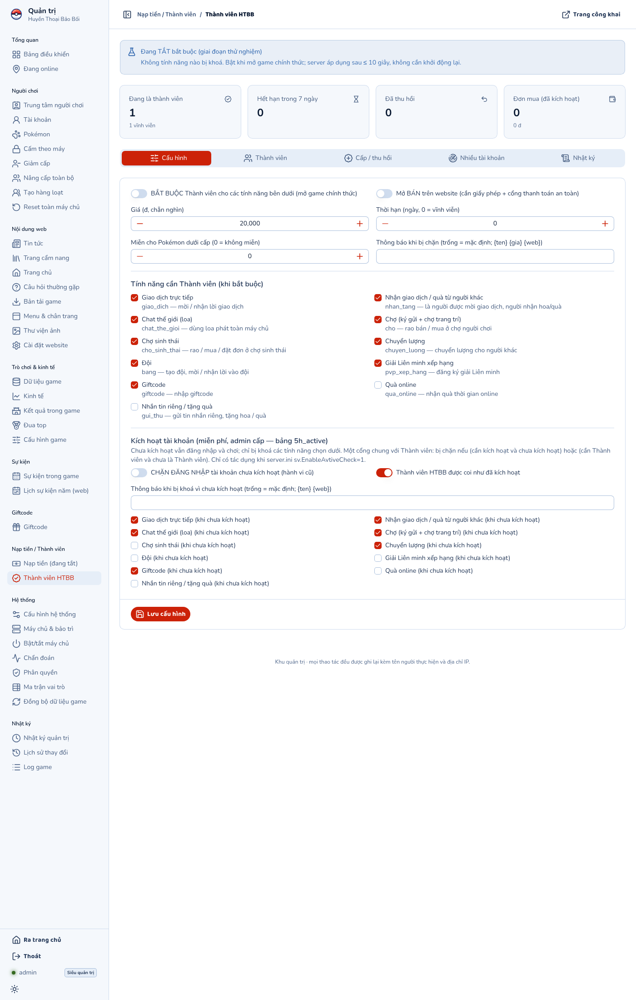 |
| 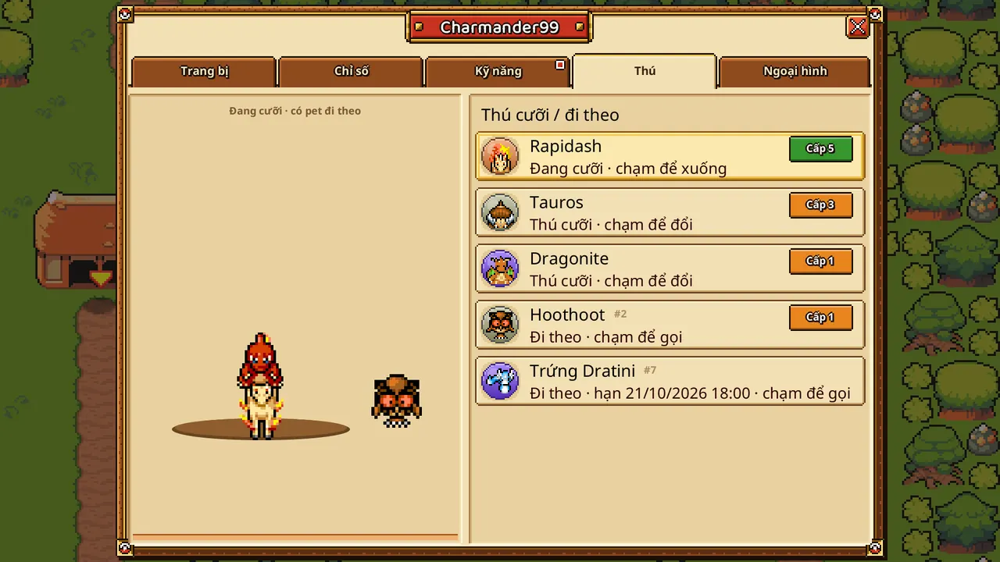 | 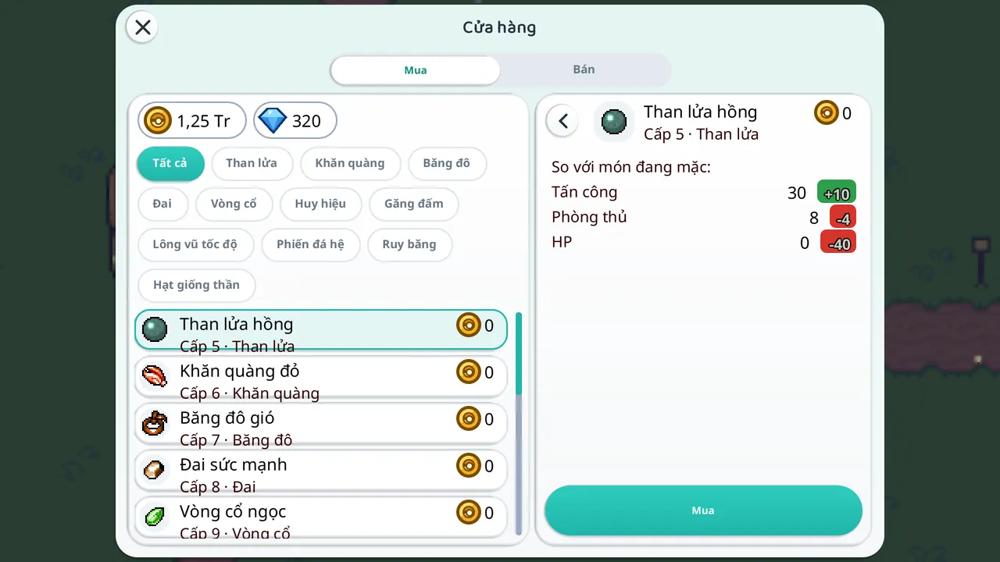 |  |

---

## Cấu trúc Monorepo

| Thư mục | Nội dung | Tài liệu |
|---|---|---|
| `server/` | Game server + Login server (Java, cổng `19129` / `8023`): `src/`, `test/`, `lib/`, `map/`, `cMap/` | [server/README.md](server/README.md) |
| `client_jar/` | Client J2ME (MIDP 2.0) — **nguồn code game duy nhất** cho JAR, Android và PC Java | [client_jar/README.md](client_jar/README.md) |
| `client_apk/` | Android module `pokemon/` sinh từ code JAR qua `port-j2me.py` | [client_apk/README.md](client_apk/README.md) |
| `client_pc/` | Bản PC Java SE chạy code JAR (Windows / macOS / Linux) | [client_pc/README.md](client_pc/README.md) |
| `client_pc_ios/` | Client Unity `6000.5.9f1` (PC Windows, Linux, iOS) | [client_pc_ios/README.md](client_pc_ios/README.md) |
| `web/` | Website + khu quản trị Nuxt 4 (Node 22), bộ ảnh gallery ở `web/public/anh-game/` | [web/README.md](web/README.md) |
| `sql/` | Tệp CSDL chuẩn hoá + script nâng cấp | [sql/README.md](sql/README.md) |
| `du_lieu/` | Bảng tài nguyên client / bản đồ (sprite, tile, NPC) | [du_lieu/README.md](du_lieu/README.md) |
| `tools/` | Công cụ tài nguyên, bot kiểm thử, bộ phát hành client (`tools/phat-hanh/`) | [tools/README.md](tools/README.md) |
| `vps/` | Tệp triển khai VPS: systemd, nginx, MariaDB, deploy, sao lưu | [vps/README.md](vps/README.md) |
| `docs/` | Tài liệu kỹ thuật đầy đủ & kho ảnh minh hoạ (`docs/anh/`) | — |

---

## Tài liệu Dự án Đầy đủ

| Tệp tài liệu | Nội dung chính |
|---|---|
| [docs/kien-truc.md](docs/kien-truc.md) | Kiến trúc thành phần, giao thức, CSDL, web ↔ game, luồng dữ liệu, bản đồ, quy ước mã |
| [docs/build.md](docs/build.md) | Build và kiểm thử từng thành phần (`server`, `client_jar`, `client_apk`, `client_pc`, Unity) |
| [docs/trien-khai.md](docs/trien-khai.md) | Dựng VPS và deploy (MariaDB, systemd, nginx, WAF, sao lưu) |
| [docs/van-hanh.md](docs/van-hanh.md) | Vận hành, log, sao lưu, bảo trì, sổ tay GM, sự kiện, giftcode, nạp tiền |
| [docs/dang-nhap.md](docs/dang-nhap.md) | Login server: giao thức game ↔ login, cấu hình, số đo cũ/mới, lên bản và quay lui |
| [docs/cau-hinh.md](docs/cau-hinh.md) | Khoá cấu hình (`server.ini` + bảng `cau_hinh`) |
| [docs/thiet-ke-game.md](docs/thiet-ke-game.md) | Thiết kế game: Pokémon, hệ & khắc hệ, chiêu, Gym, kinh tế, hệ sinh thái |
| [docs/huong-dan-gia-lap-android.md](docs/huong-dan-gia-lap-android.md) | Hướng dẫn chạy & kiểm thử trên giả lập Android |
| [docs/kiem-thu/ma-tran-bot.md](docs/kiem-thu/ma-tran-bot.md) | Ma trận kiểm thử tự động & soak bot |
| [docs/phat-hanh-va-truyen-thong.md](docs/phat-hanh-va-truyen-thong.md) | Checksum SHA-256 bản `v0.9.33-opentest`, mô tả Open Test & ghi công CC0 |
| [docs/giay-phep.md](docs/giay-phep.md) | Giấy phép và ghi công tài nguyên |

---

## Bắt đầu nhanh (máy dev)

Cần: **JDK 17+** (biên dịch `--release 8`), **MariaDB 10.4+** (không dùng MySQL 8), **Node 22**, **Python 3**.

```sh
# 1. CSDL (đặt lower_case_table_names=1 và utf8 trước, xem vps/htbb-mariadb.cnf)
mysql -u root < sql/htbb.sql

# 2. Cấu hình server: chép mẫu rồi sửa db.* (máy nhà có thể đặt db.choPhepMatKhauTrong=1)
cp vps/server.ini.linux.example server/server.ini
cp vps/loginServer.server.ini.example server/loginServer/server.ini

# 3. Login server rồi game server (chạy ở server/)
(cd server/loginServer && java -Djava.awt.headless=true -jar htbb-login.jar) &
(cd server && java -Djava.awt.headless=true -jar htbb-server.jar)

# 4. Website Nuxt 4
cd web && cp .env.example .env && npm ci && npm run dev        # http://localhost:3000

# 5. Chạy một client nối vào máy dev
MAY_CHU=127.0.0.1:19129 sh client_jar/build.sh                  # J2ME JAR (MicroEmulator)
sh client_pc/build.sh && java -jar client_pc/out/HTBB-PC.jar    # PC Java (mặc định 127.0.0.1:19129)
```

Không cần cài MariaDB khi dev nhanh: `sh tools/pokemon/chay_tren_novadb.sh` chạy toàn bộ server trên NovaDB. Chi tiết kiểm thử xem [docs/build.md](docs/build.md).

## Quy ước & Bảo mật

- Đường dẫn trong tài liệu viết **từ gốc repo** (`server/src/...`, `du_lieu/...`); test server chạy từ `server/`.
- **Không đưa mật khẩu, keystore APK, `server.ini`, `.env`, `sv.p2p_license`, hay địa chỉ IP vận hành thật vào Git.**
- GitHub Actions trong `.github/workflows/` hỗ trợ kiểm thử server, deploy web và đóng gói phát hành client (`client-phat-hanh-htbb.yml`).
