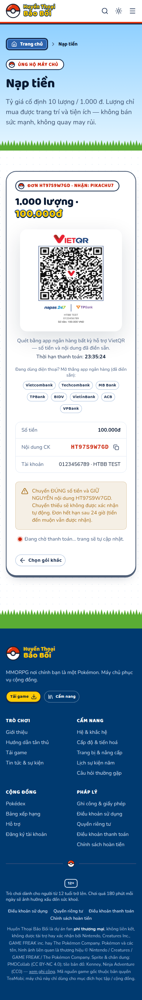
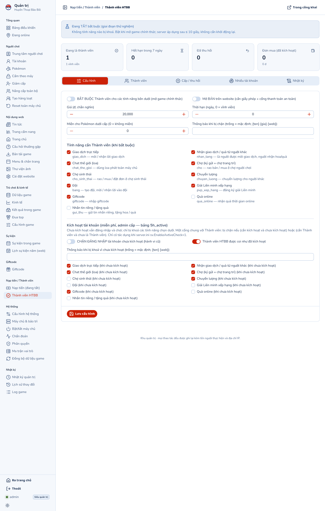

# Sổ tay vận hành — Huyền Thoại Bảo Bối

Dành cho chủ server, quản trị viên và GM của máy chủ thật (VPS). Cài đặt, dựng VPS, pipeline deploy:
[trien-khai.md](trien-khai.md). Danh mục đầy đủ khoá cấu hình: [cau-hinh.md](cau-hinh.md). Kiến trúc:
[kien-truc.md](kien-truc.md). Giấy phép tài nguyên: [giay-phep.md](giay-phep.md).

Quy ước trong tài liệu này: `<mật-khẩu>`, `<tên-miền>`, `<khoá>`… là chỗ bạn tự điền. **Không bao giờ** dán
mật khẩu, token, IP gốc của VPS vào Git, chat hay ảnh chụp màn hình.

## Bố cục trên VPS (nhắc nhanh)

| Đường dẫn | Là gì |
|---|---|
| `/opt/htbb` | bản checkout monorepo (người dùng hệ thống `htbb`) |
| `/opt/htbb/server` | `htbb-server.jar`, `server.ini` (sinh từ `vps/server.ini.tmpl`), `loginServer/`, các tệp `.txt` server tự ghi (`AdminChat.txt`, `hack.txt`…), `trang_thai.json`, `bao_tri.txt` khi đang bảo trì |
| `/opt/htbb/web` | website Nuxt (`.output` → `releases/<sha>/.output`), ảnh CMS ở `uploads/` |
| `/opt/htbb/downloads` | bản tải game, nginx phát ở `/downloads/` |
| `/opt/htbb/logs` | `game.out`, `login.out`, `gc.log`, `autodeploy.log`, `deploy-web.log`, `suc-khoe.log`, `don-log.log`, `dieu-khien-server.log`, thư mục `nhat_ky/` |
| `/opt/htbb/backups` | bản sao lưu CSDL `*.sql.gz` (root, 0750) |
| `/etc/htbb/htbb.env` | bí mật + cấu hình môi trường (root, 0600), dùng chung cho `htbb-web` và `htbb-game` |

Website: `https://huyenthoaibaoboi.fun/` (đi qua WAF). Khu quản trị: `https://huyenthoaibaoboi.fun/admin`.

---

## 1. Dịch vụ và lệnh cơ bản

| Dịch vụ | Là gì | Cổng |
|---|---|---|
| `htbb-game` | game server Java | TCP 19129 (mở ra ngoài qua WAF) |
| `htbb-login` | login server `CheckLoginSocket.jar` | TCP 8023, chỉ nội bộ |
| `htbb-web` | website + admin (Nuxt/Nitro) | 127.0.0.1:3000, nginx đứng trước |
| `nginx` | reverse proxy sau WAF | 80/443 |
| `mariadb` | CSDL `htbb_db` + `account` | 127.0.0.1:3306 |

```bash
sudo systemctl status  htbb-game htbb-login htbb-web nginx mariadb --no-pager
sudo systemctl restart htbb-web          # web: khởi động lại vô hại (vài giây)
sudo systemctl stop    htbb-game         # tắt game có trật tự (lưu dữ liệu)
sudo systemctl start   htbb-game
sudo systemctl restart htbb-game         # = stop + start
ss -lntp | grep -E '19129|8023|3000'     # cổng đang nghe
```

Thứ tự phụ thuộc: `mariadb` → `htbb-login` → `htbb-game`. Bật game sẽ kéo theo login (`Wants=`); tắt
MariaDB sẽ kéo game xuống (`Requires=`).

**Tắt game đúng cách**

- `systemctl stop` gửi **SIGTERM** → shutdown hook của `TeamServer` lưu bang, nhân vật, chợ, log rồi mới
  thoát. `TimeoutStopSec=180`: chờ tối đa 180 giây — **đừng ngắt giữa chừng**, đừng hạ con số này.
- **Không bao giờ `kill -9`** tiến trình java của game: hook lưu không chạy, người chơi mất tiến độ từ lần
  lưu tự động gần nhất.
- Muốn báo trước cho người chơi rồi mới khởi động lại: dùng *khởi động lại an toàn* từ web (mục 4.4).

**Bẫy `StartLimitBurst`.** `htbb-game` đặt `Restart=always` nhưng `StartLimitBurst=5` trong 300 giây
(login: 10/300 s). Chết/khởi động lại quá số lần đó, systemd đưa unit vào `failed` và **thôi bật lại** — server
nằm im cho tới khi có người vào sửa. Thường gặp khi `server.ini` sai mật khẩu CSDL (server tự thoát mã 1).
Sửa nguyên nhân rồi:

```bash
sudo systemctl reset-failed htbb-game
sudo systemctl start htbb-game
```

**Cập nhật code bằng tay** (bình thường pipeline tự lo, xem [trien-khai.md](trien-khai.md)):

- [`../vps/update.sh`](../vps/update.sh): kiểm repo không bị sửa tay → stop game → `git pull --ff-only` → kiểm jar
  → start. Không đụng `server.ini`, `logs/`, `backups/`, `downloads/`, `web/uploads/`.
- [`../vps/capnhat.sh`](../vps/capnhat.sh): thay nhanh một jar chép tay (`/opt/htbb/server/HTBB_NEW.jar`), giữ bản cũ
  ở `htbb-server_backup_truoc_capnhat.jar`.
- Deploy tự động sau mỗi push chỉ **kéo code**; nếu cần khởi động lại thì áp dụng ở lần bảo trì hằng ngày kế
  tiếp (mục 4.1), trừ khi chạy với `DEPLOY_NOW=1`. Log: `/opt/htbb/logs/autodeploy.log`, web:
  `/opt/htbb/logs/deploy-web.log` (web tự quay về bản trước nếu `/api/site` không trả 200).

**Bật/tắt game từ web** (`/admin/server`, không cần SSH): trang chỉ ghi trạng thái mong muốn vào bảng
`dieu_khien_server`; watcher [`../vps/dieu-khien-server.sh`](../vps/dieu-khien-server.sh) chạy bằng cron **root** mỗi phút
đọc bảng rồi gọi đúng hai lệnh cố định `systemctl start|stop htbb-game`. Hẹn giờ được. Trang báo "watcher không
sống" nghĩa là cron chưa cài:

```
# sudo crontab -e
* * * * * /opt/htbb/vps/dieu-khien-server.sh >>/opt/htbb/logs/dieu-khien-server.log 2>&1
```

(Bảng tạo bằng `du_lieu/sql_nguon/them_bang_dieu_khien_server.sql`.) Nút "Khởi động lại ngay" trên trang này bật cờ
`5h_systems.restart` — server lưu dữ liệu và thoát trong ≤ 5 giây **không báo trước**; muốn báo người chơi thì
dùng mục 4.4.

**Từ máy Windows**: các tệp `.bat` trong [`../vps/win/`](../vps/win/README.md) đi qua SSH để xem trạng thái
(`vps-trangthai.bat`), xem log trực tiếp (`vps-log.bat`), lọc lỗi (`vps-loi.bat`), chạy một câu SQL
(`vps-sql.bat "<câu SQL>"`), mở đường hầm CSDL cho HeidiSQL (`vps-db-tunnel.bat`, cổng local 3307) và tải CSDL về
máy (`vps-db-tai-ve.bat` + `vps-db-nap-vao-local.bat`). Tên máy `htbb-vps` khai trong `%USERPROFILE%\.ssh\config`
— IP gốc không ghi vào Git. Bản dump chứa dữ liệu người chơi thật: không chia sẻ.

---

## 2. Nhật ký (log)

| Tệp / nguồn | Nội dung |
|---|---|
| `/opt/htbb/logs/game.out` | stdout+stderr game (systemd ghi). Mỗi dòng `giờ mức [LOẠI] …`, mức E/W/I/D |
| `/opt/htbb/logs/nhat_ky/may_chu-*.log` | bản ghi tệp của game (lọc, gộp dòng lặp), giữ `sv.log.giuNgay` = 14 ngày |
| `/opt/htbb/logs/nhat_ky/kiem_toan-*.log` | **kiểm toán**: ADMIN, GM, NAP, GIFTCODE, CAM, BAN, KINH_TE, CHONG_SPAM… không tắt được, giữ 90 ngày |
| `/opt/htbb/logs/login.out` | login server |
| `/opt/htbb/logs/gc.log` | GC của JVM (xoay 5 × 10 MB) |
| `/opt/htbb/logs/autodeploy.log`, `deploy-web.log` | deploy game / web |
| `/opt/htbb/logs/suc-khoe.log` | kết quả kiểm sức khoẻ mỗi phút (mục 13) |
| `/opt/htbb/logs/don-log.log` | dọn bảng log CSDL |
| `/var/log/htbb-backup.log` | sao lưu + thử khôi phục (theo dòng cron trong đầu script) |
| `/opt/htbb/server/AdminChat.txt` | mọi câu chat của GM; `AdminChat_lenh47.txt`: lệnh quản trị gói 47 |
| `/opt/htbb/server/hack.txt`, `hackdo.txt` | nghi vấn gian lận (mục 12) |
| `/opt/htbb/server/errorlog.txt` | vết lỗi Java cũ + cảnh báo chặn lệnh admin trái phép |
| bảng CSDL | `tob_log_all_item`, `tob_log_*`, `saveOrtherLog`… — xem trên web `/admin/log` |

`htbb-game` và `htbb-login` **không ghi stdout vào journal** (`StandardOutput=append:`), nên `journalctl -u htbb-game`
chỉ có sự kiện start/stop/failed của systemd. Nội dung log nằm ở `game.out`.

```bash
tail -f /opt/htbb/logs/game.out                         # xem trực tiếp
journalctl -u htbb-game -n 50 --no-pager                # vì sao unit chết / failed
journalctl -u htbb-web -n 100 --no-pager                # web (Nitro ghi vào journal)
grep -E ' E \[|Exception' /opt/htbb/logs/game.out | tail -50
```

Chuỗi đáng grep trong `game.out`:

| Chuỗi | Ý nghĩa |
|---|---|
| `Load configuration file error!` | `server.ini` có dòng sai → **mọi dòng phía sau không được đọc**, server chạy với cấu hình dở dang. Phải sửa ngay |
| `[CAU HINH] AP DUNG` | một khoá cấu hình vừa áp dụng lúc chạy (`khoá: cũ -> mới`) |
| `[BAO TRI]`, `BAO TRI SAU`, `CHUAN BI THOAT` | bảo trì đăng nhập / báo trước / bắt đầu lưu và thoát |
| `[CLIENT]` | mỗi lần đăng nhập: tài khoản, IP, nền tảng, phiên bản, `ban=<số bản>` — tra theo giờ + tên khi người chơi báo lỗi |
| `NGAP GOI` | một kết nối gửi gói quá ngưỡng (bot/tool hoặc lag nặng) |
| `NAP TIEN -> BAT` / `NAP TIEN BI TAT (fail closed)` | trạng thái nạp tiền (game / web) |
| `Data too long for column` | lưu nhân vật thất bại (xem mục 14) |
| `[GIFTCODE]` | mã bị từ chối / lỗi phát quà |

Xoay vòng: [`../vps/htbb-logrotate.conf`](../vps/htbb-logrotate.conf) (`game.out`/`login.out` hằng ngày, giữ 30, `copytruncate`;
`*.log` trong `logs/` hằng tuần; các `.txt` của server hằng tháng). Các bảng log trong CSDL được
[`../vps/don-log.sh`](../vps/don-log.sh) dọn lúc 03:20 (giữ `GIU_NGAY=15` ngày, xoá theo lô để không khoá bảng MyISAM
lâu); chạy thử không xoá: `sudo /opt/htbb/vps/don-log.sh --thu`.

Mức log và chống lặp chỉnh bằng các khoá `sv.log.*` (đọc lúc khởi động) — chi tiết ở [cau-hinh.md](cau-hinh.md).

---

## 3. Sao lưu và khôi phục

**Hằng ngày 03:30** — `/etc/cron.d/htbb-backup` gọi `/usr/local/sbin/htbb-backup-db.sh` (cài từ
[`../vps/backup_db.sh`](../vps/backup_db.sh)): dump `htbb_db` và `account` bằng `mysqldump --single-transaction` (không
khoá CSDL đang chạy) ra `/opt/htbb/backups/<db>_<YYYY-MM-DD_HHMM>.sql.gz`. Mỗi bản phải qua `gzip -t` **và** có dòng
`Dump completed`; hỏng thì xoá bản hỏng và **giữ nguyên** bản cũ. Chỉ khi cả hai bản mới đạt mới xoá bản cũ hơn
14 ngày. Đăng nhập CSDL bằng root qua unix_socket, hoặc đọc `HTBB_DB_*` từ `/etc/htbb/htbb.env` vào tệp cnf tạm
(mật khẩu không lên dòng lệnh).

```bash
sudo ls -lh /opt/htbb/backups/ | tail
sudo tail -20 /var/log/htbb-backup.log
sudo /usr/local/sbin/htbb-backup-db.sh          # sao lưu ngay (trước khi làm việc nguy hiểm)
```

**Bản sao ngoài máy (khuyến nghị).** Ổ VPS hỏng là mất cả CSDL lẫn bản sao lưu. Tạo
`/etc/default/htbb-backup` (root, 0600):

```
HTBB_BACKUP_DICH="<user>@<máy-khác>:/duong/dan/htbb-backups/"
```

Sau mỗi lần sao lưu, script `rsync` cả thư mục qua SSH key (không mật khẩu tương tác). Lỗi chép ra ngoài chỉ
ghi cảnh báo, bản tại chỗ vẫn còn. Để trống = bỏ qua.

**Thử khôi phục hằng tuần** — [`../vps/kiem-khoi-phuc-csdl.sh`](../vps/kiem-khoi-phuc-csdl.sh) nạp bản mới nhất vào CSDL
tạm `<db>_kiem_khoi_phuc`, so số bảng và số dòng `tob_char tob_pet tob_clan tob_pokedex data_item` với CSDL đang chạy,
rồi xoá CSDL tạm. Không đụng CSDL thật. Cảnh báo nếu bản mới nhất cũ hơn 48 giờ. Mã thoát 1 = có vấn đề.

```
# cron root
30 4 * * 1 /opt/htbb/vps/kiem-khoi-phuc-csdl.sh >> /var/log/htbb-backup.log 2>&1
```

Chạy tay cho cả hai CSDL:

```bash
sudo /opt/htbb/vps/kiem-khoi-phuc-csdl.sh
sudo DB=account /opt/htbb/vps/kiem-khoi-phuc-csdl.sh
```

**Khôi phục thật (khi sự cố)** — làm tay, đúng thứ tự, bằng root:

```bash
sudo systemctl stop htbb-game htbb-login
zcat /opt/htbb/backups/htbb_db_<NGAY>.sql.gz | sudo mysql htbb_db
zcat /opt/htbb/backups/account_<NGAY>.sql.gz | sudo mysql account
sudo systemctl start htbb-login htbb-game
```

- Tệp dump **không** có `--databases`, nên không tự tạo/xoá CSDL: nó nạp đè lên CSDL đang có, từng bảng
  `DROP TABLE IF EXISTS` + `CREATE` lại. Bảng nào có ở CSDL hiện tại mà không có trong bản lưu sẽ còn nguyên.
- Trước khi khôi phục, chạy sao lưu ngay một lần để còn đường quay lại trạng thái trước sự cố.
- Nên bật bảo trì (mục 4.3) hoặc tắt `htbb-web` trong lúc nạp để không ai ghi dở dang.
- Mọi tiến độ của người chơi từ thời điểm bản lưu đến lúc khôi phục sẽ mất: báo trên kênh cộng đồng.
- Khôi phục bản lưu cũ hơn bản jar đang chạy: chạy lại `sudo bash /opt/htbb/vps/nang_cap_csdl.sh` trước khi bật game
  (nâng CSDL lên schema / dữ liệu thiết kế hiện tại; chạy lại được, không đụng dữ liệu người chơi — [sql/README.md](../sql/README.md)).
- Xoá dữ liệu người chơi (wipe sau open test): `vps/van_hanh/wipe_*.sql` — đọc đầu tệp, tắt server và sao lưu trước.

---

## 4. Bảo trì

### 4.1 Bảo trì hằng ngày (`BaoTriDaily`)

Game tự lưu toàn bộ dữ liệu và thoát mỗi ngày một lần; systemd (`Restart=always`) bật lại sau 10 giây. Đây
cũng là lúc code đã deploy được áp dụng. Người chơi nhận **một** thông báo chạy chữ 60 giây trước giờ bảo trì.

Giờ đặt bằng khoá `sv.gioBaoTri` (`/admin/cau-hinh-he-thong`, nhóm Bảo trì):

| Giá trị | Nghĩa |
|---|---|
| trống (mặc định) | giờ ngẫu nhiên trong khoảng 04:30–05:30, chọn lại mỗi lần JVM khởi động |
| `HH:MM` (vd `04:30`) | giờ cố định |
| `tat` | không tự bảo trì (và không báo trước) |

Việc dọn log (03:20) và sao lưu (03:30) được xếp **trước** khung giờ này.

### 4.2 Báo trước 60 giây (`baotri_thongbao`)

Bảng `5h_systems` có hai dòng lệnh:

- `command='baotri_thongbao'`: đặt `status=0` → trong ≤ 5 giây game gửi cho người đang online câu
  "Hệ thống sẽ bảo trì sau 1 phút…" rồi tự trả cờ về 1. **Chỉ báo, không tắt.** Deploy tự động dùng cờ này, đợi
  60 giây rồi mới `systemctl stop`.
- `command='restart'`: đặt `status=0` → game lưu toàn bộ và thoát ngay (systemd bật lại).

```sql
UPDATE htbb_db.5h_systems SET status = 0 WHERE command = 'baotri_thongbao';
-- đợi 60 giây, rồi: sudo systemctl restart htbb-game
```

Chỉ gửi một tin, sớm nhất có thể: client xếp tin vào hàng đợi và mỗi tin mất 15–20 giây mới trôi hết, gửi
nhiều mốc (30/20/10 giây) thì tin cuối hiện lại sau khi người chơi đăng nhập lại.

### 4.3 Chế độ bảo trì đăng nhập (chặn người mới vào)

Bật một trong hai cách (bật cái nào cũng là đang bảo trì; danh sách được vào = hợp của hai nơi):

1. **Web** `/admin/he-thong` (Máy chủ & bảo trì, chỉ Siêu quản trị): bật/tắt, câu thông báo, danh sách tài khoản
   vẫn được vào. Web ghi tệp `bao_tri.txt` và lưu lịch sử thay đổi.
2. **Tệp** `/opt/htbb/server/bao_tri.txt`:

   ```
   Máy chủ đang bảo trì, dự kiến mở lại lúc 10:30. Theo dõi trang chủ.
   cho: tentaikhoangm1 tentaikhoangm2
   ```

   Dòng đầu = câu báo người chơi (trống = câu mặc định); dòng `cho:` = **tên tài khoản** vẫn đăng nhập được (để GM
   kiểm tra trước khi mở). Xoá tệp = mở lại.
3. Khoá cấu hình `bao_tri.bat` / `bao_tri.cau` / `bao_tri.cho` ở `/admin/cau-hinh-he-thong` (áp dụng ≤ 10 giây,
   không cần quyền ghi thư mục game).

Hiệu lực trong ≤ 5 giây; **người đang chơi không bị đá**. Muốn đá hết thì tắt/khởi động lại game sau khi bật bảo
trì. Tệp chỉ được đọc khi `sv.chiSoMayChu=1` (mặc định). Nhớ tắt bảo trì sau khi xong — quên tệp `bao_tri.txt` là
lỗi "không ai vào được" hay gặp nhất.

Quy trình bảo trì có kế hoạch:

1. Báo trên kênh cộng đồng (Zalo) trước ≥ 30 phút (trừ sự cố).
2. Bật bảo trì đăng nhập, `cho:` các tài khoản GM.
3. Khởi động lại an toàn (4.4) hoặc `systemctl stop htbb-game`.
4. Làm việc cần làm (sao lưu trước nếu đụng CSDL).
5. Bật game, GM vào kiểm tra, tắt bảo trì, báo mở lại.

### 4.4 Khởi động lại an toàn từ web

`/admin/cau-hinh-he-thong` → **Khởi động lại an toàn** (chỉ Siêu quản trị): nhập số giây (10–1800) và lý do.
Luồng: web ghi `cau_hinh_khoi_dong_lai.trang_thai='cho'` → game nhận trong ≤ 5 giây, chuyển `dang_dem`, báo người
chơi và đếm ngược (bấm **Huỷ** được trong lúc đếm) → hết giờ `dang_thoat`, lưu toàn bộ dữ liệu rồi thoát →
systemd bật lại → lần khởi động mới ghi `da_xong`.

- Web từ chối nếu game không gửi nhịp quá 120 giây (game không chạy/treo) — khi đó dùng `/admin/server` hoặc SSH.
- Yêu cầu `cho` ghi lúc game đang tắt và cũ hơn 10 phút bị huỷ khi game khởi động, không gây khởi động lại bất ngờ.

---

## 5. Cấu hình lúc chạy từ web admin

Mọi công tắc và tham số chỉnh được lúc chạy nằm ở **`/admin` → Cấu hình hệ thống** (`/admin/cau-hinh-he-thong`),
lưu trong bảng `htbb_db.cau_hinh`. Danh mục khoá, kiểu, khoảng hợp lệ: [cau-hinh.md](cau-hinh.md).

**Thứ tự ưu tiên: CSDL (`cau_hinh`) > `server.ini` > mặc định trong danh mục.** Vì vậy sửa trên web thắng
`server.ini`; `server.ini` chỉ là giá trị khởi tạo. Cổng, thông tin CSDL, đường dẫn log **không** nằm trong
danh mục — chỉ đọc từ `server.ini` (sinh từ `vps/server.ini.tmpl`, đổi qua pipeline, xem
[trien-khai.md](trien-khai.md)). Bí mật (cổng thanh toán, Gmail…) ở biến môi trường; các khoá loại `env` trên
trang chỉ hiện trạng thái.

| Loại khoá | Khi nào có hiệu lực |
|---|---|
| Áp dụng ngay | game kiểm phiên bản cấu hình mỗi 5 giây (đọc lại cả bảng mỗi 60 giây) → thường **5–10 giây**; log `[CAU HINH] AP DUNG khoá: cũ -> mới` |
| Cần khởi động lại (`sv.lau_dai`, `sv.nap_tien`, `sv.he_sinh_thai`, `sv.chiSoMayChu`, cờ sự kiện cũ…) | đọc một lần lúc bật máy; giá trị mới hiện ở mục *chờ khởi động lại* cho tới khi khởi động lại (4.4) |
| Khoá thử nghiệm (`sv.testMode`, `sv.testCode`, `sv.tua_nhanh_ngay`) | bị khoá trên máy thật, chỉ nhận mặc định |

- Giá trị sai kiểu/khoảng bị **từ chối**: game giữ giá trị tốt gần nhất, trang hiện đỏ kèm lý do.
- Mỗi lần lưu ghi `cau_hinh_lich_su` (ai, khi nào, cũ → mới, lý do); tab Lịch sử có nút **Hoàn tác**. Ai đó ghi
  thẳng bảng bằng SQL cũng được game phát hiện và ghi lịch sử (`nguon=phat_hien`).
- Trang cũ `/admin/cauhinh` (Cấu hình game: tỉ lệ rơi, EXP, giờ chiếm Gym…) ghi cùng bảng `cau_hinh`.

**Lệnh `setting` trong game** (GM): `setting` mở ô nhập lệnh, `setting menu` mở menu chọn bằng chuột.

```
1                                   chiếm Gym bắt đầu sau 2 phút
2 <giờ> <phút> [ngày]               đặt giờ chiếm Gym (ngày = yyyy-MM-dd hoặc Mon..Sun)
3                                   trả về lịch chuẩn 21h thứ 3 + thứ 7
5 <xu> <lượng> <sựkiện> <bình> <ngọc> <đồ> [chiaXu]   tỉ lệ rơi (% so với gốc)
6                                   xem cấu hình đang chạy (đọc từ bộ nhớ — cách chắc nhất)
8                                   nạp lại cấu hình ngay thay vì chờ
```

Thay đổi qua `setting` cũng ghi vào `cau_hinh`. Theo quy định open test, chỉ chủ server dùng `setting`.

Sau khi đổi `server.ini` (qua deploy), luôn kiểm:

```bash
grep -c "Load configuration file error" /opt/htbb/logs/game.out   # phải không tăng sau lần khởi động mới
systemctl status htbb-game --no-pager
ss -lntp | grep 19129
```

---

## 6. Sổ tay GM

### 6.1 Quyền GM trong game và quyền quản trị web — hai thứ khác nhau

| | GM trong game | Quản trị web `/admin` |
|---|---|---|
| Gắn với | **tên nhân vật (Pokémon)** | **tên tài khoản** |
| Khai ở | `sv.adminAccounts` (danh sách tên, không phân biệt hoa/thường, cách nhau dấu phẩy) | `HTBB_ADMIN_ACCOUNTS` trong `/etc/htbb/htbb.env` (luôn là Siêu quản trị) + vai trò ở `/admin/phan-quyen` |

- `sv.gmCanCoPInfo=1` (khuyến nghị cho máy công khai): nhân vật còn phải có `pInfo[16]=1` trong `tob_char`, nên
  người chơi trùng tên trong danh sách **không** thành GM. `0` = chỉ cần tên.
- Người chơi không tạo được nhân vật trùng tên trong danh sách GM hoặc chứa chữ `admin`. Muốn tạo nhân vật GM mới:
  bật tạm `sv.choPhepTaoTenGM=1`, tạo xong **tắt ngay**.
- Lệnh quản trị gói 47 (gồm `shutdown`) chỉ nhận từ nhân vật GM **đang online**.
- Mọi câu chat của GM ghi vào `/opt/htbb/server/AdminChat.txt` và `kiem_toan-*.log` (loại `ADMIN`); lệnh gói 47
  vào `AdminChat_lenh47.txt`. **Mọi thứ bạn gõ đều để lại dấu vết.**

Vai trò web: **Siêu quản trị** (toàn quyền: máy chủ, cấu hình, giftcode, nạp tiền, thao tác hàng loạt, phân quyền),
**Biên tập** (nội dung website), **Hỗ trợ** (tra cứu, khoá/mở có hạn, cấm chat, thư, đổi mật khẩu, về điểm an toàn),
**Chỉ xem**. Ma trận đầy đủ: `/admin/vai-tro`. Có thể bắt 2FA và giới hạn IP cho admin bằng `HTBB_ADMIN_2FA_BAT_BUOC`,
`HTBB_ADMIN_IP_CHO_PHEP`.

### 6.2 Lệnh chat được dùng

| Lệnh | Tác dụng | Khi nào |
|---|---|---|
| `kick <tên>` | đá nhân vật ra (dữ liệu được lưu) | kẹt, spam, gây rối |
| `getchar <tên>` | xem chỉ số nhân vật đang online | điều tra báo cáo gian lận |
| `mto <map> <x> <y>` | dịch chuyển chính mình | đến chỗ người chơi báo lỗi |
| `tgct` | xem giờ chiếm Gym đang đặt | — |
| `setting` / `setting menu` | bảng cài đặt (mục 5) | chỉ chủ server |
| `stown …`, `ktct` | đặt / huỷ giờ chiếm Gym (mục 7) | chỉ chủ server, báo trước trên kênh |

### 6.3 Lệnh CẤM dùng trên máy công khai

Mọi lệnh tạo ra giá trị trong game: `slv`, `pet`, `gem`, `ngoc`, `qua*`, `ruong*`, `att`, `dvip`, `rsvip`, `tlixi`,
`fna`, `spt`/`sph`/`spe`… và lệnh bật/tắt boss/sự kiện (`openboss*`, `offboss*`, `onx2`…). Một lần phát đồ làm
sai số liệu kinh tế và tạo tiền lệ "xin GM". Cần trao thưởng → **giftcode** (mục 8) hoặc "Tặng quà" ở
`/admin/nguoi-choi` (qua danh sách trắng, có nhật ký) sau khi chủ server duyệt.

Lệnh `ban <tên>` trong game **không có tác dụng** (hàm đã bị vô hiệu). Khoá đúng cách ở web (6.4).

### 6.4 Xử lý vi phạm

| Mức | Hành vi | Xử lý | Công cụ |
|---|---|---|---|
| 1 | spam chat, ngôn từ xấu | nhắc → `kick` / cấm chat có hạn | chat, `/admin/nguoi-choi` |
| 2 | lợi dụng lỗi, quấy rối lặp lại | khoá tài khoản 3 ngày, thu hồi đồ có được do lỗi | `/admin/nguoi-choi`, `/admin/taikhoan`, `/admin/nhanvat` |
| 3 | hack/tool, gian lận giao dịch, mạo danh GM | khoá vĩnh viễn + cấm theo máy | `/admin/taikhoan` + `/admin/cammay` |

- Chống spam chat đã tự chạy (`sv.spam.*`): quá nhịp / trùng lặp / quảng cáo → tích điểm vi phạm → tự cấm chat
  tăng dần 1 → 5 → 30 → 120 phút, mỗi lần ghi kiểm toán `CHONG_SPAM`. GM chỉ xử lý phần còn lại.
- Cấm theo máy (`/admin/cammay`) dùng mã thiết bị client gửi (không phải MAC), có hiệu lực ≤ 60 giây.
- Ghi lý do khi thao tác (nhật ký `/admin/nhatky` lưu người làm + IP, không xoá được) và chụp màn hình bằng chứng.
- Không bao giờ hỏi mật khẩu người chơi.

**Kháng cáo**: người chơi gửi qua kênh hỗ trợ chính thức (Zalo), không qua chat game; một GM **khác** người đã khoá
xem lại bằng chứng trong 72 giờ; kết quả giữ / giảm / gỡ, ghi lý do; mỗi lần khoá kháng cáo một lần.

**Báo lỗi**: client không có nút báo lỗi. Ghim mẫu trên kênh cộng đồng: *tên nhân vật · giờ:phút · bản đồ · nền
tảng (jar/APK/PC + số bản) · mô tả · ảnh/clip*. Giờ + tên đủ để tra dòng `[CLIENT]` và lỗi trong `game.out`.

---

## 7. Sự kiện và chiếm Gym

### 7.1 Sự kiện trong game (`/admin/sukien`)

Bảng `htbb_db.tob_su_kien`. Danh sách sự kiện do game đăng lên mỗi lần khởi động; trang web chỉ ghi bật/tắt và hẹn
giờ mở/đóng. Các khoá `sv.isSuKien*` trong `server.ini` chỉ là mặc định khi bảng chưa có dòng tương ứng.

**Đổi trạng thái sự kiện chỉ có hiệu lực sau khi khởi động lại** (cửa hàng, giảm giá, NPC được dựng một lần lúc
bật máy). Mặc định game tự lo:

| Khoá | Mặc định | Ý nghĩa |
|---|---|---|
| `sv.suKienTuKhoiDongLai` | `1` | `0` = không tự khởi động lại; lịch hẹn vẫn đổi cột `bat`, trang hiện "chờ khởi động lại" |
| `sv.suKienGomGiay` | `120` (30–3600) | chờ không còn thay đổi nào trong chừng này giây mới khởi động lại — gom nhiều sự kiện thành **một** lần |
| `sv.suKienBaoTruocGiay` | `60` (10–600) | báo người chơi bao lâu trước khi tắt |

Đừng hạ `sv.suKienGomGiay`: bật liền nhiều sự kiện mà mỗi cái khởi động lại một lần sẽ chạm `StartLimitBurst`
(mục 1) và game nằm `failed`. Game không làm gì trong 3 phút đầu sau khi bật máy. Đừng hạ báo trước dưới 10 giây
(người chơi bị đá trước khi kịp thấy chữ).

`/admin/lich-su-kien` là **lịch sự kiện năm hiển thị trên web** (nội dung CMS), không bật gì trong game.

### 7.2 World Cup (bình chọn)

Bật bằng hai dòng *World Cup* ở `/admin/sukien`; ba khoá `sv.worldCupBatDau`, `sv.worldCupKetThuc`,
`sv.worldCupHanNhanQua` (`yyyy-MM-dd HH:mm:ss`, phải `batDau < ketThuc <= hanNhanQua`) chỉ là mặc định khi bảng chưa
có dòng. Trống = tắt. Lần đầu mở sự kiện chạy `du_lieu/sql_nguon/them_su_kien_world_cup.sql` một lần (tạo bảng điểm, đặt tên vật
phẩm hộp quà). Giai đoạn `batDau → ketThuc`: đánh quái nhặt Quả bóng vàng, đổi phiếu bầu; `ketThuc → hanNhanQua`:
người bầu cho bên thắng nhận quà ở NPC.

### 7.3 Chiếm Gym

Lịch chuẩn: **21h thứ 3 và thứ 7**, mỗi phiên 1 tiếng. Đổi lịch:

- `/admin/cau-hinh-he-thong` (nhóm Sự kiện): `sv.gioChiemThanh` (0–23, `-1` = lịch chuẩn), `sv.phutChiemThanh`,
  `sv.ngayChiemThanh` (trống = mỗi ngày; `Mon,Sat`… hoặc một ngày `yyyy-MM-dd`). Áp dụng ngay.
- Trong game (GM): `stown 1 <giờ> <phút> [yyyy-MM-dd|Mon..Sun]`; `stown 0` hoặc `ktct` trả về lịch chuẩn; `tgct` xem
  giờ đang đặt; `setting` lệnh 1/2/3. Các lệnh này cũng lưu vào `cau_hinh`.

Tạm đóng thách đấu Gym (không phải chiếm Gym): `gym.bat=0`. Kết quả các trận/phiên xem ở `/admin/bang-game`.

---

## 8. Giftcode

Máy chủ thật chạy chế độ dài hạn (`sv.lau_dai=1`), nên game dùng **giftcode an toàn** (bảng `tob_giftcode` +
`tob_giftcode_log`). Bảng `giftcode` kiểu cũ (phát xu/lượng/đồ tuỳ ý) **không còn được game đọc**; trang web vẫn
xem/sửa được nó qua nút "Mã kiểu cũ" chỉ để tra lịch sử.

### 8.1 Tạo / tắt mã ở `/admin/giftcode` (Siêu quản trị)

Điền: mã (3–32 ký tự `a-z 0-9 _ -`, không phân biệt hoa thường), phần thưởng, hạn dùng (tuỳ chọn), tổng lượt, cấp tối
thiểu, ghi chú. Trang kiểm phần thưởng ngay khi gõ và hiện giá trị/ngân sách tháng. Nút bật/tắt để tạm khoá mã,
xoá để bỏ hẳn; tab nhật ký cho biết ai đã nhận.

Cú pháp phần thưởng (nhiều phần cách nhau dấu phẩy) — **chỉ ba loại, đều là đồ khoá**:

| Loại | Ý nghĩa | Giá trị tính trần |
|---|---|---|
| `LUONGKHOA:n` | n lượng khoá | n |
| `GEM:id:n` | n ngọc/nguyên liệu id (luôn khoá) | n |
| `ITEM:id:n` | n vật phẩm id (n ≤ 10, khoá) | 5 × n |

Xu, lượng mở, thú, trang bị tuỳ ý… bị từ chối. Ví dụ: `LUONGKHOA:10,ITEM:<id>:2`.

Luật khi người chơi nhập (theo thứ tự):

1. Nhập sai 5 lần → khoá nhập 10 phút (theo tài khoản).
2. Tối đa `giftcode.toi_da_thang` mã / tháng (mặc định 2).
3. Mã phải tồn tại, đang bật, chưa hết hạn, nhân vật đủ cấp.
4. Tổng giá trị phần thưởng ≤ `giftcode.gia_tri_toi_da` (mặc định 30); vật phẩm phải nằm trong danh sách trắng và
   trang bị không vượt cấp nhân vật.
5. Ngân sách toàn máy chủ mỗi tháng `giftcode.ngan_sach_thang` (mặc định 20 000 điểm giá trị) — hết thì báo "hẹn
   tháng sau".
6. **Mỗi tài khoản nhận một lần mỗi mã** (khoá chính `(ma, user_id)`), trừ lượt có điều kiện, rồi mới phát.

Tính năng `giftcode` còn có thể bị khoá với tài khoản chưa kích hoạt (`kich_hoat.chuc_nang`, mục 10).

### 8.2 Tra cứu bằng SQL

Trên VPS: `sudo mysql -t -e "<câu SQL>"`; từ Windows: `vps-sql.bat "<câu SQL>"`.

```sql
-- các mã và lượt đã dùng
SELECT ma, phan_thuong, han, tong_luot, da_dung, cap_toi_thieu, bat FROM htbb_db.tob_giftcode ORDER BY tao_luc DESC;
-- 30 lượt nhận gần nhất
SELECT ma, user_id, charname, phan_thuong, gia_tri, luc FROM htbb_db.tob_giftcode_log ORDER BY luc DESC LIMIT 30;
-- một tài khoản đã nhận mã chưa (vì sao "đã nhập rồi")
SELECT * FROM htbb_db.tob_giftcode_log WHERE ma = 'tenma' AND user_id = <id tài khoản>;
-- ngân sách tháng đã dùng (thang = yyyyMM)
SELECT thang, SUM(gia_tri) AS da_dung, COUNT(*) AS luot FROM htbb_db.tob_giftcode_log GROUP BY thang ORDER BY thang DESC;
-- tắt một mã ngay
UPDATE htbb_db.tob_giftcode SET bat = 0 WHERE ma = 'tenma';
```

Nên tạo/sửa mã qua web (có kiểm luật và nhật ký). Mã chèn bằng SQL mà sai luật sẽ bị game từ chối lúc nhập
(log `[GIFTCODE] ma … bi tu choi`).

**Bẫy cũ cần biết** nếu ai đó chạy lại chế độ không dài hạn: bảng `giftcode` cũ có `type` phải = 0, `limit_use` là
số lượt **còn lại** (số âm = vô hạn), cột `expire` không bao giờ được đọc, và một mục phần thưởng sai làm mất mọi
phần sau. Không phát lượng lớn qua bảng cũ: lượng là `int`, tràn sẽ làm nhân vật tự bị khoá.

---

## 9. Nạp tiền (SePay)

> **Hiện đang TẮT**: game `sv.nap_tien=0`, web `HTBB_NAP_BAT=false`. Chỉ bật sau khi có **giấy phép bằng văn bản**
> cho hình ảnh/tên Pokémon và tài sản CC BY-NC (xem [giay-phep.md](giay-phep.md)) hoặc đã thay bằng tài sản tự sở hữu.

### 9.1 Nguyên tắc (không đổi khi bật)

- Bán thời gian/tiện ích/trang trí, **không bán sức mạnh**: cửa hàng chỉ nhận trang trí, mở rộng túi, đổi tên và
  đúng 5 món tăng tốc EXP cố định (chung trần ngày/tuần với bản kiếm bằng chơi). Không bán chỉ số, trang bị, đá, tỉ lệ.
- Tỷ giá cố định 10 lượng / 1.000 đ, không khuyến mãi %, không gacha. Mọi lượng tiêu ra bị đốt.
- Gói (`/admin/naptien` › Gói): L20…L500 (20.000–500.000 đ), Thẻ tháng 50.000 đ (20 lượng/ngày × 30), Vé mùa cao cấp
  99.000 đ.
- Trần chi tiêu mỗi tài khoản: `tran_tuan_vnd` = 1.000.000 đ/tuần, `tran_thang_vnd` = 2.000.000 đ/tháng; người chơi tự
  đặt trần thấp hơn được.

### 9.2 Nhiều lớp fail-closed — thiếu một lớp là không thu tiền

| Lớp | Ở đâu | Điều kiện |
|---|---|---|
| Web bật nạp | `HTBB_NAP_BAT=true` (biến môi trường) | |
| Giấy phép | `NAP_DA_CO_GIAY_PHEP=1` | chưa có → `/admin/naptien` hiện cảnh báo đỏ |
| Cấu hình cổng | `HTBB_NAP_ACCOUNT_NO`, `HTBB_NAP_ACCOUNT_NAME`, `HTBB_NAP_BANK_BIN`, `HTBB_SEPAY_WEBHOOK_APIKEY`, `HTBB_ADMIN_NAPTIEN_PASSWORD` (≥ 12 ký tự), `HTBB_SECRET` (≥ 32 ký tự) | thiếu/yếu/mặc định một khoá → web tự tắt, log `NAP TIEN BI TAT (fail closed)`, hộp đỏ liệt kê lý do |
| Sandbox | `HTBB_NAP_SANDBOX` **không** được đặt trên máy thật | đặt trên máy thật cũng làm nạp tắt |
| Game | `sv.lau_dai=1` **và** `sv.nap_tien=1` (cần khởi động lại) | log `NAP TIEN -> BAT` |
| Công tắc từng loại (áp dụng ngay, `/admin/cau-hinh-he-thong` nhóm Nạp tiền) | `nap.luong.bat`, `nap.the_thang.bat`, `nap.ve_mua.bat` (ẩn gói + chặn đơn mới), `nap.tang_toc.bat` (cửa hàng tăng tốc trong game), `nap.hoan_tien.thu_cong`, `nap.hoan_tien.tu_dong` | đọc lỗi = coi như tắt |

### 9.3 Bật nạp an toàn (checklist)

1. **Giấy phép** đã có bằng văn bản → mới làm tiếp. Luật sư rà `/dieu-khoan-thanh-toan`, `/chinh-sach-hoan-tien`, và
   sửa `/dieu-khoan` (đang ghi "không nạp tiền").
2. **CSDL**: bảng nạp đã có chưa? Nếu chưa: `sudo mysql htbb_db < /opt/htbb/du_lieu/sql_nguon/pokemon_nap_tien.sql` (chạy lại an toàn).
   Sao lưu trước.
3. **SePay** (my.sepay.vn — tên menu có thể đổi theo phiên bản):
   - Đăng ký, liên kết **đúng** tài khoản ngân hàng nhận tiền (số tài khoản → `HTBB_NAP_ACCOUNT_NO`, tên chủ tài khoản
     viết HOA không dấu → `HTBB_NAP_ACCOUNT_NAME`, mã BIN ngân hàng → `HTBB_NAP_BANK_BIN`, bảng BIN trong
     [`../web/.env.example`](../web/.env.example)).
   - Cấu trúc mã thanh toán: tiền tố `HT`, phần sau 8 ký tự chữ + số (mã đơn web dạng `HT` + 8 ký tự `A–Z 2–9`). Có
     cấu hình này SePay tự điền trường `code`; không có thì web tìm mã trong nội dung chuyển khoản.
   - Webhook: sự kiện **Có tiền vào**, URL `https://<tên-miền>/api/nap/webhook-sepay`, chứng thực **API Key** = chuỗi
     ngẫu nhiên ≥ 24 ký tự (`openssl rand -hex 24`), đặt cùng chuỗi vào `HTBB_SEPAY_WEBHOOK_APIKEY`; Content-Type
     `application/json`.
   - (Tuỳ chọn) API token → `HTBB_SEPAY_API_TOKEN`: web dò giao dịch lỡ webhook mỗi `HTBB_SEPAY_DO_PHUT` phút (2–5),
     nhìn lại `HTBB_SEPAY_DO_GIO` giờ. Khoá trùng là `id` giao dịch SePay nên không bao giờ cộng hai lần.
4. **Biến môi trường web**: đặt các khoá ở 9.2 qua GitHub Secrets/Variables (deploy gộp vào `/etc/htbb/htbb.env`) hoặc
   sửa thẳng `/etc/htbb/htbb.env` rồi `sudo systemctl restart htbb-web`. Mở `/admin/naptien`: **không còn hộp đỏ**.
5. **Game**: `/admin/cau-hinh-he-thong` đặt `sv.nap_tien=1` (`sv.lau_dai` đã là 1) → khởi động lại an toàn → grep
   `NAP TIEN -> BAT` trong `game.out`; `/admin/naptien` › Đối soát thấy nhịp server.
6. **Giao dịch thử thật**: nhân vật online, tạo đơn L20 (20.000 đ) trên web, quét QR (số tiền + nội dung điền sẵn).
   Vài giây sau trang đổi "Đã thanh toán", khoảng 15 giây sau "Đã cộng vào nhân vật", trong game +200 lượng. Kiểm
   `/admin/naptien` › Nhật ký (webhook `ok`, sổ cái `thanh_toan` + `cong`) và nhật ký webhook bên SePay.
7. Theo dõi tab **Đối soát** hằng ngày trong tuần đầu.



### 9.4 Luồng đơn và đối soát

`cho_thanh_toan` → (webhook/admin xác nhận) `da_thanh_toan` → (game cộng khi nhân vật online, vòng 15 giây)
`da_cong`. Quá 24 giờ chưa trả → `that_bai` (tiền đến muộn **vẫn** được xác nhận và giao). Một giao dịch ngân hàng
không thể xác nhận hai đơn; webhook gửi lặp bị bỏ qua.

| Tình huống | Kết quả / việc của admin |
|---|---|
| đúng tài khoản, đúng mã, đủ tiền | tự động giao |
| tiền vào tài khoản khác | bỏ qua, ghi `sai_tai_khoan` |
| không có / sai mã đơn | ghi `khong_co_ma_don` / `khong_thay` → Đối soát, cộng tay nếu xác minh được |
| chuyển **thiếu** | đơn giữ "chờ", ghi số đã nhận → admin xác nhận tay khi khách chuyển bù, hoặc hoàn |
| chuyển **dư** | giao + ghi phần dư → admin hoàn phần dư |
| đơn `da_cong` nhưng `da_luu_nv=0` (server sập giữa lúc cộng và lưu) | Đối soát liệt kê → kiểm nhân vật, cộng tay nếu thiếu |

Xác nhận tay theo mã giao dịch sao kê: `/admin/naptien` › Đơn, hoặc trang `/xac-nhan-nap` (mật khẩu
`HTBB_ADMIN_NAPTIEN_PASSWORD`, bắt buộc mã giao dịch).

### 9.5 Hoàn tiền / chargeback

- Chính sách (`/chinh-sach-hoan-tien`): hoàn khi lỗi giao hàng 24 giờ, chuyển trùng/dư, hoặc trong 7 ngày nếu chưa dùng.
- Thao tác: `/admin/naptien` › Đơn › **Hoàn tiền** (lý do bắt buộc, công tắc chargeback). Cần `nap.hoan_tien.thu_cong=1`.
  Chuyển tiền trả lại làm **ngoài hệ thống**, ghi mã giao dịch hoàn vào lý do.
- Đơn chưa vào game → `hoan_tien`. Đơn đã cộng → `cho_thu_hoi` → game (khi `nap.hoan_tien.tu_dong=1`) chuyển lượng
  thành **nợ** của tài khoản (`da_thu_hoi`): trừ dần vào lượng đang có, lượng nạp sau trả nợ trước; thẻ tháng −30 ngày,
  vé mùa mất track cao cấp. Nợ > 0 khoá cửa hàng và đổi tên. Chargeback còn khoá tạo đơn mới.
- Mọi thao tác ghi `nap_nhat_ky` + nhật ký admin.

---

## 10. Thành viên và kích hoạt tài khoản

Hai bậc, **một cổng** kiểm chung trong game; cấu hình ở `/admin/thanh-vien` (ghi: Siêu quản trị; Hỗ trợ chỉ xem),
áp dụng ≤ 10 giây, không cần khởi động lại.

| | Kích hoạt (`5h_active`) | Thành viên HTBB (`tv_thanh_vien`) |
|---|---|---|
| Giá | miễn phí — admin cấp | trả phí (mặc định 20.000 đ, theo **tài khoản**) |
| Mục đích | lọc clone rẻ | chặn clone mạnh hơn khi mở chính thức |
| Đăng nhập | chưa kích hoạt **vẫn vào chơi** (`kich_hoat.chan_dang_nhap=0`) | không bao giờ chặn đăng nhập |
| Khoá tính năng | `kich_hoat.chuc_nang` (mặc định `giao_dich,chat_the_gioi,cho,chuyen_luong,nhan_tang,giftcode`) | `thanh_vien.chuc_nang` khi `thanh_vien.bat=1` |
| Hiện trạng | đang dùng | **TẮT** (`thanh_vien.bat=0`, `thanh_vien.ban_bat=0`) |

Bị chặn nếu (cần kích hoạt và chưa kích hoạt) **hoặc** (cần Thành viên và chưa là Thành viên). Người chơi nhận lời
nhắn trỏ về `/kichhoat` hoặc `/thanh-vien`. `kich_hoat.thanh_vien_la_kich_hoat=1` (mặc định): Thành viên được coi như
đã kích hoạt. Mọi thứ chỉ có nghĩa khi `sv.EnableAvtiveCheck=1` (đang bật; `0` = coi mọi tài khoản đã kích hoạt).



**Kích hoạt tài khoản**

- Thủ công: `/admin/taikhoan` (hoặc hồ sơ ở `/admin/nguoi-choi`) → **Kích hoạt** cộng 30 ngày; **Huỷ kích hoạt** xoá dòng
  `5h_active`. Có nhật ký thay đổi.
- Tự động khi đăng ký: web theo `HTBB_AUTO_ACTIVATE`; đăng ký trong game theo `sv.dangKyTuKichHoat` (`web` = theo cấu
  hình web, `1` = luôn, `0` = không).
- Người chơi xem trạng thái ở `/kichhoat` và `/account` (không tự gia hạn được).

**Bật Thành viên khi mở chính thức**

1. Cổng thanh toán đã chạy an toàn (mục 9.3 bước 2–4; Thành viên dùng chung đơn/sổ cái/webhook). Chạy
   `du_lieu/sql_nguon/pokemon_thanh_vien.sql` **sau** `du_lieu/sql_nguon/pokemon_nap_tien.sql` nếu chưa có bảng.
2. `/admin/thanh-vien` › Cấu hình: chọn tính năng, giá (`thanh_vien.gia`, đồng bộ gói `THANH_VIEN`), thời hạn
   (`thanh_vien.thoi_han_ngay`, 0 = vĩnh viễn), miễn cho nhân vật dưới cấp N (`thanh_vien.mien_cap`) → bật **Mở BÁN**
   (`thanh_vien.ban_bat`). Bán thật chỉ khi đủ giấy phép + cổng an toàn — hộp đỏ cho biết thiếu gì. Mở bán Thành viên
   độc lập với `HTBB_NAP_BAT` (webhook vẫn mở khi đang bán Thành viên).
3. Khi công bố mở chính thức, bật **BẮT BUỘC** (`thanh_vien.bat=1`).
4. Cấp miễn phí cho tester/đối tác: tab **Cấp / thu hồi** (một hoặc hàng loạt ≤ 500 tài khoản, lý do bắt buộc).

Mua: `/thanh-vien` → đơn `THANH_VIEN` → thanh toán → cấp **ngay** trên web (không cần vào game). Hoàn tiền ở
`/admin/naptien` thu hồi đúng số ngày đã cấp (lần vĩnh viễn → thu hồi hẳn). Mọi lần cấp/gia hạn/thu hồi ghi
`tv_nhat_ky` + nhật ký admin. Thành viên không cho xu/lượng/sức mạnh — chỉ mở khoá tính năng.

Tab **Nhiều tài khoản**: mã máy dùng chung bởi nhiều tài khoản và IP chung — chỉ để xem xét (máy gia đình, quán net
cũng chung máy); xử lý bằng cấm theo máy nếu chắc chắn.

---

## 11. Email (Gmail OAuth)

Web gửi thư (quên mật khẩu, đổi email/mật khẩu) qua Gmail API bằng refresh token, quyền **duy nhất** `gmail.send`
(không đọc được hộp thư). Thiếu một trong bốn biến `HTBB_GMAIL_CLIENT_ID`, `HTBB_GMAIL_CLIENT_SECRET`,
`HTBB_GMAIL_REFRESH_TOKEN`, `HTBB_GMAIL_SENDER` = tắt gửi mail. Tên người gửi: `HTBB_MAIL_FROM_NAME`.

**Bước 1 — Google Cloud Console** (một lần, đăng nhập đúng tài khoản Gmail sẽ gửi thư):

1. Tạo project → APIs & Services → Library → **Gmail API** → Enable.
2. OAuth consent screen: External; thêm scope `https://www.googleapis.com/auth/gmail.send`; Audience → **Publish app**
   ("In production"). Để "Testing" thì refresh token hết hạn sau 7 ngày.
3. Credentials → Create OAuth client ID loại **Desktop app** → lấy Client ID + Client secret. (Loại "Web application"
   thì phải khai redirect URI `http://127.0.0.1:<cổng>/`.)

**Bước 2 — Lấy refresh token** trên máy có trình duyệt và Node ≥ 20, từ thư mục `web/`
([`../web/scripts/lay-gmail-refresh-token.mjs`](../web/scripts/lay-gmail-refresh-token.mjs)):

```bash
node scripts/lay-gmail-refresh-token.mjs <client_id> <client_secret> [cổng, mặc định 8765]
```

Script mở máy chủ nhỏ ở `http://127.0.0.1:<cổng>/` và in link xin quyền. Mở link, đăng nhập đúng tài khoản Gmail gửi
thư, bấm Cho phép (gặp "Google chưa xác minh ứng dụng này" → Nâng cao → Đi tới …). Google chuyển về máy bạn, script
đổi mã lấy token và in ra `HTBB_GMAIL_REFRESH_TOKEN`.

**Bước 3 — Cài lên máy chủ**: đặt bốn biến (+ `HTBB_MAIL_FROM_NAME`) vào GitHub Secrets (deploy web gộp vào
`/etc/htbb/htbb.env`) **hoặc** sửa thẳng `/etc/htbb/htbb.env` (root, 0600), rồi `sudo systemctl restart htbb-web`.
Thử bằng chức năng quên mật khẩu với một tài khoản của bạn.

- Refresh token + client secret là **bí mật** (đủ để gửi thư dưới tên bạn): không dán vào chat, không commit.
- Lỗi `invalid_grant` trong `journalctl -u htbb-web`: gỡ quyền ứng dụng ở https://myaccount.google.com/permissions rồi
  chạy lại bước 2.

---

## 12. Chống gian lận và rà soát nhật ký

### 12.1 `hack.txt` và `hackdo.txt`

Ở `/opt/htbb/server/`, đọc được ngay trên `/admin/chandoan`. `hack.txt` = nghi vấn chung, `hackdo.txt` = nghi vấn vật
phẩm. Một sự kiện = một dòng năm cột ` | `:

```
<ngày giờ> | <tên nhân vật> | <IP> | <loại> | <chi tiết>
```

Xuống dòng bị lọc và `|` trong dữ liệu người chơi bị đổi thành `/`, nên không ai tự chế được dòng log và `grep` theo
tên luôn đếm đúng:

```bash
grep ' | TenNhanVat | ' /opt/htbb/server/hack.txt | wc -l
awk -F' \\| ' '{print $4}' /opt/htbb/server/hackdo.txt | sort | uniq -c | sort -rn
```

Hạn mức ghi: mỗi nhân vật 20 dòng/giờ, cả server 500 dòng/giờ (chạm trần ghi một dòng báo rồi im đến giờ sau) — để một
phép kiểm báo động giả không làm đầy ổ đĩa.

| Loại | Khi nào |
|---|---|
| `hackchonchar` | chọn nhân vật thuộc tài khoản khác |
| `ngapgoi` | vượt 300 gói thường / 600 gói tài nguyên trong 5 giây |
| `hackdoimap` | đổi bản đồ trái phép |
| `hackc` | giao thẻ khi không ở đúng bản đồ |
| `loiinvent` | lưu hành trang thất bại → server tự khoá nhân vật (xem mục 14) |
| `hackbitem` | mua món không có trong danh sách bán của gian hàng |
| `hackR` | gọi lệnh sửa đồ khi đang ở bản đồ online |
| `ffbug` | vật phẩm lỗi cũ / hết hạn còn trong túi hoặc rương |
| `hackgd` | giao dịch thuốc bất thường (lời mời không tồn tại, số lượng hai bên không khớp, vượt 999…) |

Cố ý **không** ghi các phép kiểm có tỉ lệ báo động giả cao: nhặt đồ khi máu về 0, kéo về chỗ cũ khi dịch chuyển bất
thường (mạng kém), kick khi thoát game. Một dòng lẻ chưa phải bằng chứng — xem mẫu lặp lại theo thời gian.

**Lỗ hổng phát hiện đã biết**: không có cơ chế tự phát hiện đánh nhanh bằng tool (bộ đếm tốc độ đánh cũ không còn hoạt
động). Dựa vào báo cáo người chơi, `getchar`, và so tiến độ bất thường trên `/admin/kinh-te`.

### 12.2 Nguồn rà soát khác

| Nguồn | Dùng để |
|---|---|
| `/opt/htbb/logs/nhat_ky/kiem_toan-*.log` | lệnh GM, giftcode, nạp, cấm/ban, cấm chat tự động — luôn ghi nguyên vẹn |
| `/opt/htbb/server/AdminChat.txt`, `AdminChat_lenh47.txt` | soát GM có dùng lệnh cấm không (6.3) |
| `/admin/nhatky` | mọi thao tác trên web admin, kèm người làm và IP (không xoá được) |
| `/admin/lich-su-thay-doi` | trước/sau của từng thay đổi (cấu hình, bảo trì, tài khoản…) |
| `/admin/log` | bảng log game (vd `?bang=tob_log_all_item&loc2=loiinvent`) |
| `/admin/kinh-te` | nguồn vào/ra, người giữ nhiều nhất, cảnh báo lạm phát (số liệu ngày ghi lúc 04:00) |
| `/admin/thanh-vien` › Nhiều tài khoản, bảng `tob_may_dang_nhap` | một máy dùng những tài khoản nào (clone) |
| `game.out` | `NGAP GOI`, `[CLIENT]` (IP, nền tảng, số bản) |

Nhịp rà soát gợi ý: hằng ngày lướt `hack*.txt` + cảnh báo kinh tế; hằng tuần soát `AdminChat*.txt` và kiểm toán GIFTCODE/ADMIN.

Ép cập nhật client: `sv.banToiThieu=N` từ chối jar/APK có số bản build `< N` (kèm link tải). Client PC không gửi số bản nên
luôn qua. Đây là công cụ buộc cập nhật khi bản cũ có lỗi nghiêm trọng, **không** phải chống giả mạo client.

---

## 13. Kiểm tra sức khoẻ

[`../vps/kiem-suc-khoe.sh`](../vps/kiem-suc-khoe.sh) kiểm từng tầng (systemd chỉ cứu được khi JVM **chết**, không biết khi
JVM treo mà cổng vẫn mở):

1. **game**: bắt tay thật tới cổng 19129 (gửi gói -40, phải nhận lại), đo ms;
2. **nhịp**: `/opt/htbb/server/trang_thai.json` (game ghi mỗi 30 giây) phải mới hơn `NGUONG_TREO` = 120 giây;
3. **login**: cổng 8023 mở;
4. **csdl**: `SELECT 1`;
5. **web**: `GET $WEB_URL/api/trang-thai` trả 200 (bỏ qua nếu `WEB_URL` trống).

Một dòng kết quả, mã thoát 0 = khoẻ:

```
<ngày giờ> game=ok(12ms) nhip=ok(8s,online=37) login=ok csdl=ok web=ok
```

Cài cron root (nếu chưa có); `TU_KHOI_DONG_LAI=1` = game/nhịp hỏng **2 phút liên tiếp** thì `systemctl restart htbb-game`
(hook vẫn lưu dữ liệu):

```
* * * * * TU_KHOI_DONG_LAI=1 WEB_URL=http://127.0.0.1:3000 /opt/htbb/vps/kiem-suc-khoe.sh >> /opt/htbb/logs/suc-khoe.log 2>&1
```

```bash
sudo /opt/htbb/vps/kiem-suc-khoe.sh                 # chạy tay
grep -v ' game=ok' /opt/htbb/logs/suc-khoe.log | tail   # các lần có tầng hỏng
```

**Chỉ số máy chủ**: game ghi mỗi 30 giây một dòng vào `tob_chi_so_may_chu` (giữ 7 ngày) và `trang_thai.json`: kết nối,
nhân vật online, heap, số thread, CPU, tải máy, gói vào, gói bị bỏ, kết nối bị cắt vì ngập, lỗi xử lý gói, cờ bảo trì,
cùng bộ đếm nhật ký/chặn spam. Xem biểu đồ ở `/admin/he-thong` (tự tải lại 30 giây; "im lặng > 90 giây" = game không ghi
nhịp). Tắt bằng `sv.chiSoMayChu=0` (cần khởi động lại; tắt luôn đọc `bao_tri.txt` và nhịp cho script sức khoẻ).

Dấu hiệu cần để ý trên biểu đồ: heap sát trần 1,5 GB kéo dài; `loi_xu_ly` tăng đột biến; `cat_ngap`/`goi_bo` cao (bot
hoặc tấn công); online tụt về 0 đột ngột.

Kiểm nhanh tài nguyên máy:

```bash
df -h /opt                          # ổ đĩa (game.out, backups)
free -m                             # RAM (game ≤ 2,4 GB, MariaDB ~1 GB, web ≤ 640 MB)
du -sh /opt/htbb/logs /opt/htbb/backups
```

---

## 14. Sự cố thường gặp

| Triệu chứng | Kiểm | Xử lý |
|---|---|---|
| Không ai đăng nhập được, game vẫn chạy | `ls /opt/htbb/server/bao_tri.txt`, khoá `bao_tri.bat`, `/admin/he-thong` | tắt bảo trì |
| `htbb-game` trạng thái `failed`, không tự bật | `journalctl -u htbb-game -n 50`, `tail -100 /opt/htbb/logs/game.out` | sửa nguyên nhân (thường CSDL/`server.ini`), rồi `systemctl reset-failed htbb-game && systemctl start htbb-game` |
| Game bật nhưng không vào được / mất tính năng lạ | `grep "Load configuration file error" game.out` | sửa dòng sai trong `vps/server.ini.tmpl`/biến deploy, deploy lại, khởi động lại |
| Đăng nhập báo "Có lỗi xảy ra khi đăng nhập" | `systemctl status htbb-login`, `tail /opt/htbb/logs/login.out` | khởi động lại `htbb-login`; kiểm `loginServer/server.ini` (cần `characterEncoding=UTF-8` trong `db.url`) |
| Game treo (cổng mở, không phản hồi) | `suc-khoe.log` báo `nhip=TREO`/`game=HONG` | nếu chưa bật tự khởi động lại: `systemctl restart htbb-game` (không `kill -9`); xem `gc.log` nếu nghi hết heap |
| Nhân vật "biến mất" khỏi danh sách chọn | `SELECT charname, ban, del FROM htbb_db.tob_char WHERE charname='<tên>'`; `/admin/log?bang=tob_log_all_item&loc2=loiinvent`; `grep "Data too long" game.out` | lưu hành trang thất bại thì server tự đặt `ban=1`: tìm nguyên nhân (hành trang quá lớn), rồi mở khoá ở `/admin/nhanvat`. Các cột `tob_char.equip/inven/bag/tuido` phải là `MEDIUMTEXT` (cột `TEXT` chỉ chứa ~140 món). Phần tiến độ từ lần lưu thành công cuối **đã mất** |
| Website 502 / trắng | `systemctl status htbb-web`, `journalctl -u htbb-web -n 100`, `tail /opt/htbb/logs/deploy-web.log` | `systemctl restart htbb-web`; deploy hỏng thì web tự quay về bản trước |
| Đổi sự kiện mà game không khởi động lại | `/admin/sukien` hiện "chờ khởi động lại"; `sv.suKienTuKhoiDongLai` | khởi động lại an toàn (4.4) |
| Đổi cấu hình không ăn | trang Cấu hình hệ thống: khoá đỏ (bị từ chối) hay "chờ khởi động lại" | sửa giá trị / khởi động lại an toàn |
| Đầy ổ đĩa | `df -h`, `du -sh /opt/htbb/logs/* \| sort -h` | xoá bản nén log cũ; kiểm logrotate (`logrotate -d /etc/logrotate.d/htbb`); một lỗi lặp có thể làm `game.out` phình rất nhanh — tìm và sửa lỗi đó |
| Sao lưu không chạy / cảnh báo "bản mới nhất > 48 giờ" | `tail /var/log/htbb-backup.log`, `ls -lt /opt/htbb/backups` | chạy tay `htbb-backup-db.sh`, đọc lỗi; kiểm `/etc/cron.d/htbb-backup` |
| `/admin/server` báo watcher không sống | `sudo crontab -l` | cài cron `dieu-khien-server.sh` (mục 1) |
| `/admin/naptien` có hộp đỏ | đọc danh sách lý do | thiếu/yếu biến môi trường hoặc chưa có giấy phép — đúng thiết kế (fail closed) |
| Người chơi báo không nhận giftcode | `tob_giftcode` (bat, han, da_dung/tong_luot, cap), `tob_giftcode_log`, log `[GIFTCODE]` | xem luật 8.1; tài khoản chưa kích hoạt có thể bị khoá tính năng `giftcode` |
| Mail quên mật khẩu không tới | `journalctl -u htbb-web \| grep -i gmail` | đủ 4 biến `HTBB_GMAIL_*`? `invalid_grant` → lấy lại refresh token (mục 11) |
